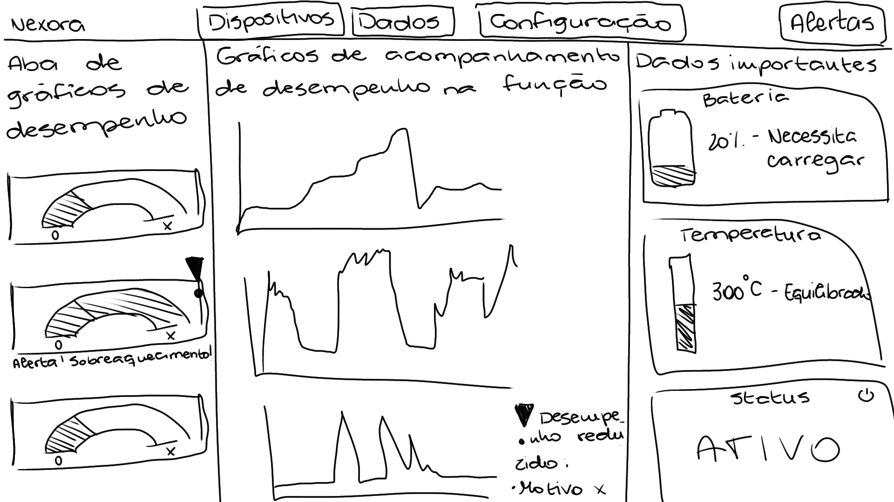
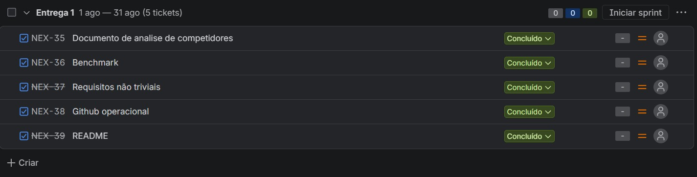
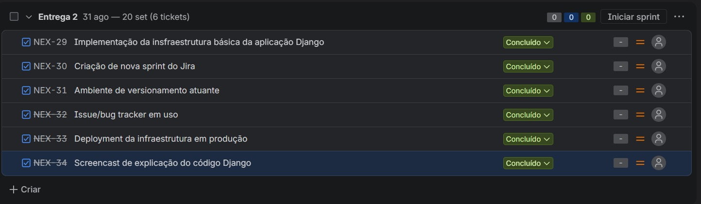
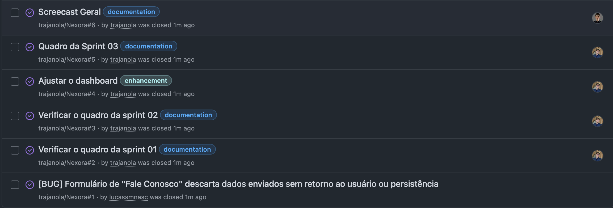
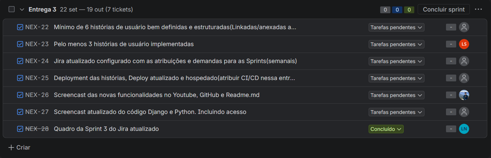

# _NEXORA_

## 👥 &nbsp;Integrantes do Projeto

<div align="center">

| Membro | E-mail |
| :---: | :---: |
| Arthur Santana de Andrade | **asa4@cesar.school** |
| Lucas Silva Moreira do Nascimento | **lsmn@cesar.school** |
| Mariana de Melquiades Melo | **mmm4@cesar.school** |
| Matheus Trajano de Freitas | **mtf@cesar.school** |
| Paulo Ferreira Fonseca dos Santos | **pffs@cesar.school** |
| Ricardo Amorim Bayma | **rab5@cesar.school** |
| Lucas Berenguer Avelino de Souza | **lbas@cesar.school** |
| Matheus Guerra Britto | **mgb3@cesar.school** |

</div>

## 🎯 &nbsp;Contexto e Propósito

A maioria das empresas falha na adoção de IoT não por falta de sensores, mas por incapacidade de **transformar** dados brutos em inteligência aplicável. O objetivo central da _NEXORA_ é ir além de um simples dashboard passivo: a plataforma foi desenhada para educar as empresas, traduzindo sinais operacionais em percepção de **valor financeiro e orientação estratégica**.

## 📝 &nbsp;Descrição do Projeto

A _NEXORA_ é uma plataforma desenvolvida para modernizar, simplificar e otimizar a gestão de ecossistemas educacionais. O sistema conecta alunos, professores e administradores em um ambiente integrado, intuitivo e funcional, facilitando o acompanhamento acadêmico, a organização de conteúdos e a comunicação institucional.

## ⚙️ &nbsp;Funcionalidades da plataforma
<details>
<summary><b>Funcionalidades do projeto</b> (clique para expandir)</summary>
Depois de criar uma conta e entrar, o usuário pode:

- Cadastrar dispositivos com localização, limite de consumo e custo estimado de reparo preventivo.
- Consultar o histórico recente de leituras de cada dispositivo.
- Configurar a tarifa de energia da empresa em R$/kWh.
- Acompanhar no painel o custo mensal do consumo excedente e, quando há custo de reparo cadastrado, o payback estimado em meses.
- Configurar uma linha de base mensal e um fator de emissão para acompanhar eficiência energética, economia de kWh e CO2e evitado.
- Simular crédito BNDES com valor financiado, desconto configurável, juros e prazo, sem substituir a análise da instituição financeira.
- Enviar mensagens pelo formulário Fale Conosco; a equipe consulta as mensagens no Django Admin.
- Convidar novos membros para a empresa como Financeiro ou Gerente de Manutenção. O Gerente de Manutenção não pode acessar os parâmetros financeiros.

O primeiro usuário de cada cadastro cria a empresa e recebe o perfil de Proprietário. Convites por e-mail podem ser aceitos por uma conta existente ou usados para criar uma conta; expiram após sete dias. Ao aceitar com uma conta existente, os dispositivos e a tarifa da empresa individual são associados à empresa convidante; dados de uma empresa com outros membros permanecem com essa empresa. Em desenvolvimento, os e-mails são exibidos no terminal; para envio real, configure `EMAIL_BACKEND` e `DEFAULT_FROM_EMAIL` no ambiente.

Cada dispositivo possui um token próprio. Na página de detalhes do dispositivo, copie o token e envie leituras para `POST /api/leituras/` como JSON:

```bash
curl -X POST http://127.0.0.1:8000/api/leituras/ \
  -H "Content-Type: application/json" \
  -H "X-Device-Token: <token-do-dispositivo>" \
  -d '{"valor_kwh": 42.7}'
```

O token autentica o dispositivo na API; mantenha-o privado. O custo exibido no painel considera somente a parcela de cada leitura acima do limite, multiplicada pela tarifa configurada.

Para sincronizar várias leituras, envie uma lista no mesmo endpoint. O campo `id_externo` torna o envio idempotente:

```bash
curl -X POST http://127.0.0.1:8000/api/leituras/ \
  -H "Content-Type: application/json" \
  -H "X-Device-Token: <token-do-dispositivo>" \
  -d '{"leituras":[{"id_externo":"sensor-001-0001","valor_kwh":42.7},{"id_externo":"sensor-001-0002","valor_kwh":43.1}]}'
```

Leituras válidas são persistidas mesmo quando outra entrada do lote é rejeitada; nesse caso a API responde `207`. Reenviar o mesmo `id_externo` não cria uma duplicata.

Na tela **Tarifa**, o proprietário ou usuário financeiro também pode informar o consumo base mensal e o fator de emissão. O painel compara as leituras do mês com essa linha de base. A tela **Crédito BNDES** calcula uma simulação configurável usando o sistema de amortização Price; os parâmetros não representam uma oferta oficial do BNDES.

</details>

## 🛠️ &nbsp;Tecnologias Utilizadas

<div align="center">


</div>

## 💻 &nbsp;Como Rodar o Projeto Localmente
<details>
<summary><b>Requisitos funcionais para rodar localmente</b> (clique para expandir)</summary>

### Pré-requisitos

- Git instalado (`git --version` para conferir)
- Python 3.12 ou superior (`python --version`)
- Um editor de código, como o VS Code

### 1. Clonar o repositório

```bash
git clone https://github.com/trajanola/Nexora.git
cd Nexora
```

Se você configurou chave SSH, pode usar a URL SSH:

```bash
git clone git@github.com:trajanola/Nexora.git
```

### 2. Criar e ativar o ambiente virtual

O ambiente virtual isola as dependências do projeto das do resto do seu computador.

**Windows (PowerShell):**

```powershell
python -m venv venv
venv\Scripts\Activate.ps1
```

**Linux / macOS:**

```bash
python3 -m venv venv
source venv/bin/activate
```

Quando estiver ativo, o terminal mostra `(venv)` no começo da linha.

### 3. Instalar as dependências

Com o ambiente virtual ativo, dentro da pasta `Nexora`:

```bash
pip install -r requirements.txt
```

### 4. Configurar a variável de ambiente `SECRET_KEY`

O projeto lê a `SECRET_KEY` do Django a partir de uma variável de ambiente (`config/settings.py`). Sem ela, o servidor não inicia e mostra o erro `KeyError: 'SECRET_KEY'`.

Gere uma chave:

```bash
python -c "from django.core.management.utils import get_random_secret_key; print(get_random_secret_key())"
```

Depois defina a variável no terminal, **antes** de rodar o servidor (vale apenas para a sessão atual do terminal):

**Windows (PowerShell):**

```powershell
$env:SECRET_KEY = "cole-a-chave-gerada-aqui"
```

**Linux / macOS:**

```bash
export SECRET_KEY='cole-a-chave-gerada-aqui'
```

> Nunca coloque a `SECRET_KEY` real dentro do código nem envie arquivos com segredos ao GitHub.

### 5. Preparar o banco de dados

O projeto usa SQLite (`db.sqlite3`), então não é necessário instalar nem configurar um banco separado.

```bash
python manage.py migrate
```

Opcional, para acessar o painel administrativo:

```bash
python manage.py createsuperuser
```

### 6. Rodar o servidor

```bash
python manage.py runserver
```

Abra http://127.0.0.1:8000 no navegador. O painel administrativo fica em http://127.0.0.1:8000/admin.

### Deploy no Render

O arquivo `render.yaml` descreve o Web Service, o PostgreSQL, as migrations e a coleta de arquivos estáticos. O Render deve receber:

- `SECRET_KEY`: segredo gerado ou armazenado pelo Render;
- `DEBUG=False`;
- `ALLOWED_HOSTS`: o domínio `onrender.com` do serviço;
- `CSRF_TRUSTED_ORIGINS`: a URL HTTPS completa do serviço;
- `DATABASE_URL`: preenchida automaticamente quando o banco do blueprint for criado.

Localmente, a ausência de `DATABASE_URL` mantém o SQLite. No Render, a variável seleciona o PostgreSQL sem alteração de código.

Para parar o servidor, use `Ctrl+C` no terminal.

### Problemas comuns

| Problema | Solução |
|---|---|
| `python: command not found` | Use `python3`, ou instale o Python |
| `ModuleNotFoundError` | O ambiente virtual não está ativo ou faltou o `pip install -r requirements.txt` |
| `KeyError: 'SECRET_KEY'` | A variável de ambiente não foi definida neste terminal (veja o passo 4) |
| Página sem estilo e `404` para o CSS no terminal | Os templates devem começar com `` e usar `<link rel="stylesheet" href="">` |
| Erro de permissão no PowerShell ao ativar o venv | Rode `Set-ExecutionPolicy -Scope CurrentUser RemoteSigned` |

### Fluxo do dia a dia

Para pegar as novidades do repositório:

```bash
git pull
pip install -r requirements.txt
python manage.py migrate
```

Para contribuir, crie uma branch antes de mexer no código:

```bash
git checkout -b minha-feature
```

### Testes automatizados

Os testes Django são executados com:

```bash
python manage.py test
```

Os testes de navegador usam Selenium e Chrome. Instale as dependências de desenvolvimento e execute-os em modo headless:

```powershell
pip install -r requirements-dev.txt
$env:SECRET_KEY = "chave-local-de-teste"
$env:DEBUG = "False"
$env:SELENIUM_HEADLESS = "1"
python manage.py test core.tests_e2e --verbosity=2
```

Para abrir o navegador durante a execução, use `$env:SELENIUM_HEADLESS = "0"`. O Chrome precisa estar instalado localmente; o Selenium Manager providencia o driver compatível.
</details>

## 📅 &nbsp;Entregas do Projeto

<details>
<summary><b>📌 Entrega 1: Pesquisa, Benchmarking e Prototipagem</b> (clique para expandir)</summary>

<br>

Nesta primeira etapa, estruturamos a base conceitual, a análise de mercado e a prototipagem inicial do projeto **Nexora**, definindo nossos diferenciais competitivos e o escopo da Sprint 01.

---

### 🔍 Pesquisa e Documentação

* **[Desk Research](https://www.figma.com/board/jxNemj7jNW6uGalSK9BPTA/Projetos-2?t=3C9odntDyPqumqQf-0):** Levantamento inicial de requisitos, dores dos usuários e alinhamento estratégico no Figma.
* **[Documento de Análise de Competidores](https://github.com/trajanola/Nexora/blob/main/Documenta%C3%A7%C3%A3o_Interface.md):** Detalhamento técnico e estrutural dos concorrentes diretos e indiretos no GitHub.

---

### 📊 Benchmark da Análise de Competidores

Comparativo de funcionalidades, capacidade e segurança entre plataformas de mercado e o **Nexora**:

| Funcionalidade / Competidor | atDesigner-TP | Plataforma IoT Tecnolog | Node-RED | Blynk IoT | AWS IoT Core | 🚀 _NEXORA_ |
| :--- | :---: | :---: | :---: | :---: | :---: | :---: |
| **Interface simples e de fácil uso** | ❌ | ✅ | ❌ | ✅ | ❌ | **✅** |
| **Reúne informações de forma eficiente** | ❌ | ❌ | ❌ | ✅ | ❌ | **✅** |
| **Ferramentas personalizáveis** | ✅ | ❌ | ✅ | ❌ | ✅ | **✅** |
| **Qtd. de dispositivos simultâneos** | 32 | 20–30 | 15–25 | 10–20 | 30–40 | **50** |
| **Segurança e controle de acesso** | ❌ ❌ | ✅ ❌ | ❌ ❌ | ✅ ❌ | ✅ ✅ | **✅ ✅** |

---

### 💻 Prototipagem e Planejamento

#### Protótipo Não Funcional da Interface


#### Quadro de Acompanhamento - Sprint 01


</details>
  
<details>
<summary><b>📌 Entrega 2: Infraestrutura, Deploy e Código</b> (clique para expandir)</summary>

<br>

Apresentação dos screencasts demonstrativos da infraestrutura em produção e arquitetura do código Django, acompanhado do quadro da Sprint 02.

---

### 🎥 Demonstrações em Vídeo
- 🎬 **[Screencast Deployment da infraestrutura em produção](https://youtu.be/GkYC9-hXWlg)**
- 🎬 **[Screencast de explicação do código Django](https://youtu.be/Fvb92Io1STo)**

---

### 📋 Planejamento e Acompanhamento

#### Quadro da Sprint 02


</details>

<details>
<summary><b>📌 Entrega 3: Histórias de Usuário e Implementação</b> (clique para expandir)</summary>

<br>

Mapeamento das Histórias de Usuário com cenários de testes operacionais em BDD (Gherkin), funcionalidades entregues e acompanhamento do backlog no Jira.

---

### 📖 Histórias de Usuário

Todas as histórias, escritas com cenários de validação em BDD (Gherkin): **[historias-de-usuario.md](./docs/historias-de-usuario.md)**

### ✅ Histórias Implementadas

---

- **US11 — Criar conta:** cadastro com nome de usuário, e-mail, empresa, confirmação e validação da senha; usuário único e senha armazenada com hash pelo Django.
- **US12 — Entrar e sair da plataforma:** autenticação, redirecionamento ao painel após login, proteção das áreas privadas e encerramento de sessão via logout.
- **US13 — Fale Conosco:** validação e persistência das mensagens, confirmação de envio e consulta pela equipe no Django Admin.
- **US15 — Perfis e isolamento por empresa:** dados compartilhados apenas entre membros da mesma empresa; Proprietário pode enviar convites para novos membros com perfil Financeiro ou Gerente de Manutenção, sem acesso financeiro para o gerente.
- **US03 — Traduzir anomalias em custo e payback:** custo mensal calculado sobre o consumo excedente e prazo estimado de retorno do reparo preventivo quando há custo cadastrado.
- **US21 — Cadastrar e listar dispositivos:** cadastro de dispositivos com localização e limite de consumo, com acesso restrito à empresa do usuário.
- **US22 — Registrar e consultar leituras:** recebimento de leituras pela API autenticada com token do dispositivo e consulta do histórico recente.
- **US23 — Acompanhar custos de anomalias:** configuração de tarifa compartilhada pela empresa e painel mensal que calcula o custo do consumo acima do limite dos dispositivos.
- **US18 — Gerenciar ordens de serviço:** criação de rascunhos por dispositivo, aprovação com registro do responsável e horário, acompanhamento da execução e conclusão com causa, ação realizada e tempo de parada.

### 🎥 Demonstrações em Vídeo

---

- 🎬 **[Screencast de explicação do código Django](https://youtu.be/MTF9BKQNVtI?si=Ci19lpYDu7i5IkUc)**

### 👾 Print Issue:

---

#### Quadro da Issue


### 📋 Backlog (Jira)

---

#### Quadro da Sprint 03


</details>

<details>
<summary><b>📌 Entrega 4: Próximas histórias de usuário</b> (clique para expandir)</summary>

<br>

As histórias abaixo estão no backlog e **ainda não foram implementadas**. Os cenários completos estão no documento de [Histórias de Usuário](./docs/historias-de-usuario.md).

### US19 — Notificações consolidadas e priorizadas

**Como** Gerente de Manutenção (Carlos), **quero** receber notificações somente de alertas críticos e consolidados por causa raiz, **para** agir rapidamente sem interrupções irrelevantes.

**Critérios de aceite:**
- Ocorrências de severidade alta geram notificação com orientação e link para a ocorrência.
- Ocorrências de severidade baixa não geram notificação.
- Sinais da mesma máquina e causa, recebidos em até cinco minutos, são agrupados em uma única notificação.
</details>

## 🔗 &nbsp;Links Importantes

-  📑 [&nbsp;Jira](https://nexora-cesar.atlassian.net/jira/software/projects/NEX/summary?atlOrigin=eyJpIjoiOTVmMjUwY2UzMzlkNDExOTgzMDMxZjRjNzMxNDI0OTUiLCJwIjoiaiJ9)
-  **O BackLog das entregas se encontra na aba de documentos do Jira.**
-  Deploy em Desenvolvimento: [Clique Aqui](https://nexora-oadm.onrender.com/)

## 🐞 &nbsp;Encontrou um bug?
- Abra uma issue na aba **[Issues](https://github.com/trajanola/Nexora/issues)** do repositório e inclua os passos para reproduzir o problema.
